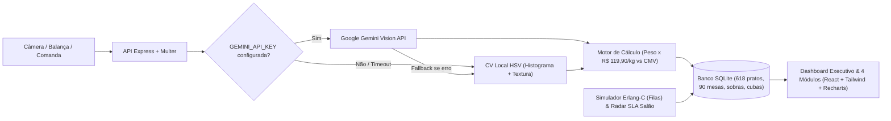

# 🥩 Bovinu'S Vision AI

> **Visão Computacional + Telemetria Operacional em Tempo Real para o almoço do Bovinu'S Grill & Beer — Unidade Augusta.**

[](https://github.com/)
[](https://nodejs.org/)
[](https://react.dev/)
[](https://www.sqlite.org/)
[](https://ai.google.dev/)

---

## 👥 Identificação da Equipe

- **Grupo:** **O Cubo e Os Mágicos**
- **Instituição / Evento:** Hackathon FMU Tech 2026.2 — Parceria **Bovinu'S Grill & Beer (Unidade Augusta)**

| Integrante | RA |
| :--- | :--- |
| **Allan Reis da Conceição** | `1539160` |
| **Gabriel Noriler Souza** | `1642714` |
| **Mayara Franciele Santos da Silva** | `1873454` |

---

## 🎯 Contexto Real & Problema Resolvido

Na operação de almoço self-service por peso da **Unidade Augusta** do Bovinu'S Grill & Beer, os números reais mostram a dimensão do desafio:

- **Preço:** `R$ 119,90/kg` (ou `R$ 113,00` no Buffet Livre por pessoa)
- **Consumo médio semanal:** `482 gramas/cliente`
- **Fluxo médio diário:** `~618 clientes/dia` (Faturamento-base projetado: `R$ 35.715,33/dia`)
- **Identificação do cliente:** Cartão Consumo / Comanda física com código de barras (ex.: `1579`, `1411`, `1531`)
- **Capacidade real (~90 mesas):** Salão Inferior / Pista (`20` mesas) · Salão Principal (`30` mesas) · Salão Superior (`40` mesas)
- **Fluxo do cliente:** `Pratos → Saladas → Quentes → Churrasqueira → Balança → Mesa`

### As 4 Dores Reais da Operação

1. **Mix do Prato Servido:** A balança sabe que o cliente pegou `482 g`, mas não sabe *o quê* está no prato. Um prato com 70% de picanha tem margem totalmente diferente de um prato com 70% de arroz, feijão e salada.
2. **Filas e Tempo do Cliente:** No pico das 12h30, formam-se gargalos na **Churrasqueira** e na **Balança**, além de atrasos no 1º atendimento de bebida na mesa.
3. **Limpeza do Salão:** Com ~90 mesas em três ambientes, mesas sujas no Salão Superior demoram para ser liberadas, reduzindo o giro no pico.
4. **Qualidade & Desperdício:** Falta visibilidade sobre quais alimentos estão voltando nos pratos (sobra) e quais cubas estão paradas no buffet.

### Escopo Estrito do Projeto

- **Foco total:** Jornada do cliente no almoço (se servir e ser atendido) + Inteligência Operacional para o gerente.
- **Fora de escopo (não implementado deliberadamente):** Gestão de cozinha/compras/estoque, pagamentos online/checkout financeiro ou mudança do modelo de negócio (cardápio digital / à la carte).

---

## 💡 A Solução: Bovinu'S Vision AI

Uma plataforma Web Full-Stack que une **Visão Computacional Híbrida** e **Telemetria Operacional em Tempo Real** em **4 módulos integrados + Dashboard Executivo**:

1. **Módulo 1 — Balança Inteligente com Visão Computacional:**
   - Captura por **3 pratos de exemplo**, **upload de foto** ou **webcam ao vivo** + número da comanda e peso em gramas.
   - **Pipeline Híbrido e Infalível:** utiliza **Google Gemini Vision** quando `GEMINI_API_KEY` está configurada e aciona automaticamente o **Analisador Local HSV (histograma de cores + textura + densidade)** caso esteja offline/sem chave — a demonstração **nunca falha**.
   - Exibe bounding boxes visuais, calcula **Valor Cobrado × CMV Estimado × Margem Real (%)** e classifica o prato (*Alta Margem*, *Equilibrada* ou *Alerta de Proteína Nobre*), persistindo no SQLite.
2. **Módulo 2 — Monitor de Filas e Gargalos:**
   - Modelo de Teoria das Filas **M/M/c (Erlang-C)** em cima da curva horária real de 618 clientes/dia.
   - Simulação ao vivo de **Horário de Pico (12h30)** vs. **Horário Normal (14h00)** e controle dinâmico de reforço de equipe (`- / +` cortadores, balanças e garçons) com alertas acionáveis.
3. **Módulo 3 — Radar de Salão e SLA de Limpeza:**
   - Planta interativa das **90 mesas** divididas nos 3 salões reais (`Principal 30 · Superior 40 · Inferior/Pista 20`).
   - Status clicável em tempo real: **Livre**, **Ocupada**, **Aguardando Limpeza** (com cronômetro vivo) e **Crítico (> 5 min)** com alerta pulsante para a equipe de garçons.
4. **Módulo 4 — Termômetro de Desperdício e Qualidade:**
   - **Scanner de Retorno (Sobra no Prato)** por registro rápido ou Visão Computacional, gerando o **Ranking de Alimentos Mais Rejeitados**.
   - **Giro das Cubas do Buffet** (alerta de baixa saída e desvio térmico RDC 216) + **Feedback Rápido na Comanda**.
5. **Dashboard Executivo:**
   - Consolida os KPIs reais direto do SQLite, gráficos interativos (Recharts), insights cruzados entre os 4 módulos e projeção financeira (ROI).

---

## 🏗️ Arquitetura do Sistema



---

## 📸 Capturas de Tela

> Adicione as imagens reais na pasta `docs/screenshots/` com os nomes abaixo antes de publicar o repositório:

| Tela | Preview |
| :--- | :--- |
| **1. Dashboard Executivo** | `docs/screenshots/01-dashboard.png` *(adicionar captura)* |
| **2. Balança Inteligente IA (Bounding Boxes)** | `docs/screenshots/02-balanca-ia.png` *(adicionar captura)* |
| **3. Monitor de Filas e Gargalos** | `docs/screenshots/03-monitor-filas.png` *(adicionar captura)* |
| **4. Radar de Salão (90 Mesas & SLA)** | `docs/screenshots/04-radar-salao.png` *(adicionar captura)* |
| **5. Termômetro de Desperdício & Qualidade** | `docs/screenshots/05-desperdicio.png` *(adicionar captura)* |

---

## 🎬 Vídeo Demo & Apresentação

- **Vídeo Demo (até 2 min):** `[INSERIR LINK DO VÍDEO AQUI]`
- **Apresentação (até 5 slides):** `[INSERIR LINK DOS SLIDES AQUI]` — veja o roteiro completo e falas cronometradas em [docs/APRESENTACAO_5_SLIDES.md](docs/APRESENTACAO_5_SLIDES.md).

---

## 🚀 Instalação e Execução (Passo a Passo)

### Pré-requisitos
- **Node.js 20+** (testado em Node v24 LTS) e **npm**.
- *(Opcional)* Uma chave gratuita do Google Gemini (`GEMINI_API_KEY`) obtida no Google AI Studio. **Sem a chave, o sistema funciona 100% offline com Visão Computacional local.**

### 1. Clonar e instalar dependências
```bash
git clone https://github.com/allanreis01/bovinus-vision-ai.git
cd bovinus-vision-ai
npm install
```

### 2. Configurar variáveis de ambiente *(opcional)*
```bash
cp .env.example .env
# Se desejar ativar o Gemini Vision, preencha GEMINI_API_KEY no arquivo .env
```

### 3. Subir Backend + Frontend com um único comando
```bash
npm run dev
```
- **Frontend (React + Vite):** http://localhost:5173
- **Backend API (Express + SQLite):** http://localhost:3001/api/health

> Na primeira execução, o banco SQLite (`backend/data/bovinus.db`) é criado e populado automaticamente com os **618 pratos** (média exata de `482 g`), **90 mesas**, **20 cubas**, sobras e feedbacks realistas da Unidade Augusta.

### Outros comandos úteis
```bash
npm test          # Executa os testes automatizados da API e regras de negócio
npm run lint      # Verifica ESLint no frontend e no backend
npm run build     # Gera o build de produção do frontend
npm run seed      # Recria e reseta o banco SQLite com os dados iniciais
```

---

## 📊 Análise de Impacto e ROI Estimado (Unidade Augusta)

Tomando como base a operação real de almoço (**618 clientes/dia × 482 g × R$ 119,90/kg = R$ 35.715,33/dia**, em 26 dias úteis/mês):

| Alavanca Operacional | Ação Habilitada pelo Sistema | Ganho Mensal Estimado |
| :--- | :--- | ---: |
| **Mix do Prato (`+1,5 p.p.` na margem)** | Controle do ritmo de cortes nobres nos horários de alerta após 13h30 | **+ R$ 13.928,98 / mês** |
| **Filas & Giro de Mesa (`+2%` de fluxo no pico)** | Reforço antecipado na churrasqueira e limpeza no Salão Superior em ≤ 5 min | **+ R$ 18.573,27 / mês** |
| **Redução de Desperdício (`-30%` de sobras)** | Ajuste de tamanho de cubas e retirada de itens com alta rejeição | **+ R$ 2.287,52 / mês** |
| **Total Estimado** | **Retorno operacional combinado** | **~ R$ 34.789,77 / mês** |

---

## 🛠️ Stack Tecnológica

- **Frontend:** React 19, Vite, Tailwind CSS v4, Recharts, Lucide React
- **Backend:** Node.js, Express 5, Multer, SQLite (`better-sqlite3` com fallback automático para `node:sqlite`)
- **Visão Computacional:** `@google/genai` (Gemini Vision) + Analisador Local HSV (`jpeg-js` / `pngjs`)
- **Qualidade:** ESLint 10 + Testes Automatizados (`node:test`)
